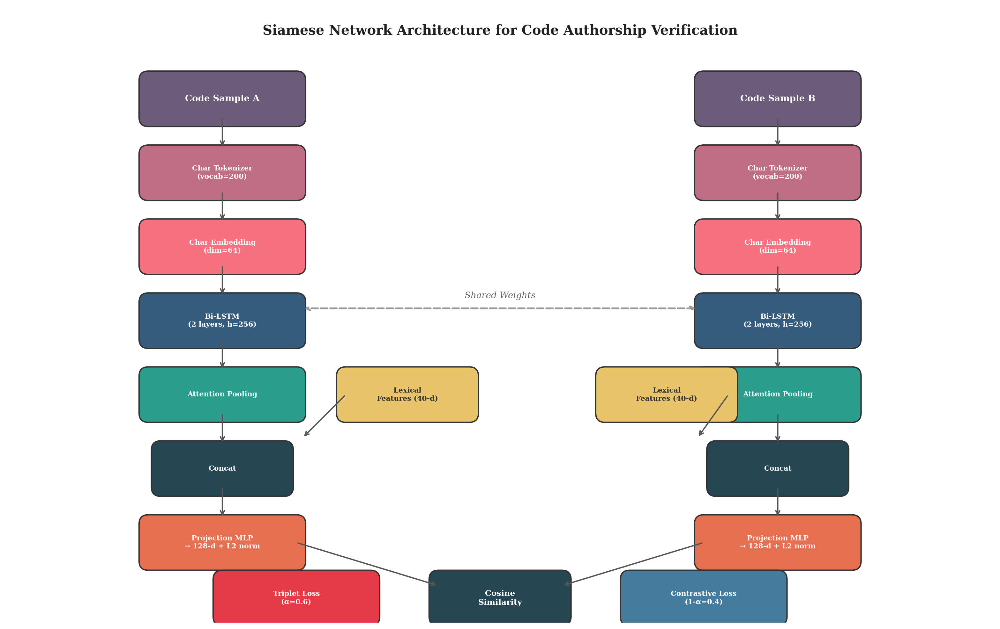
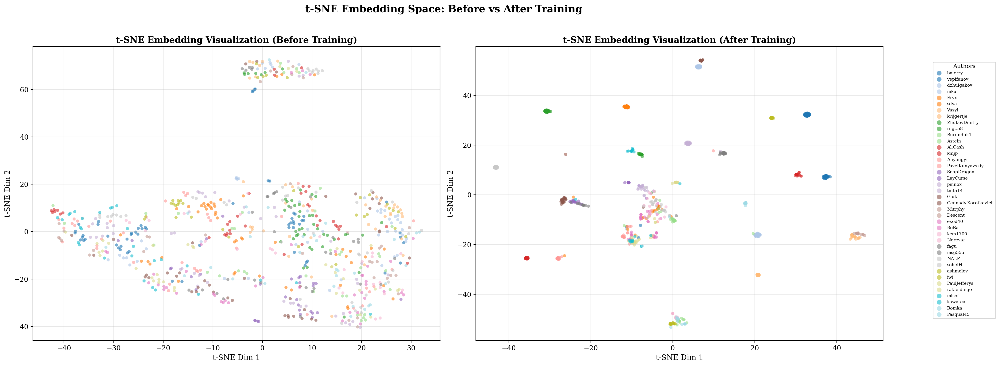
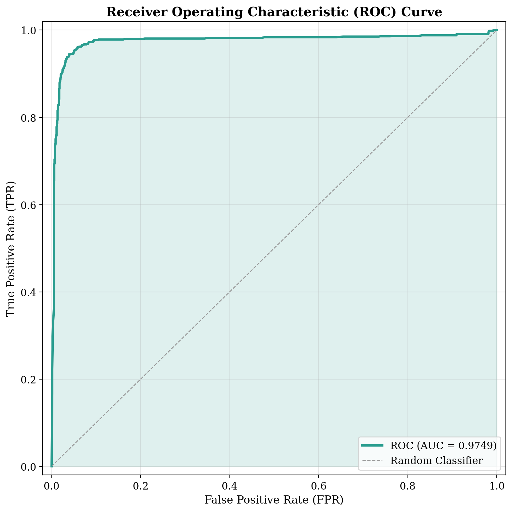
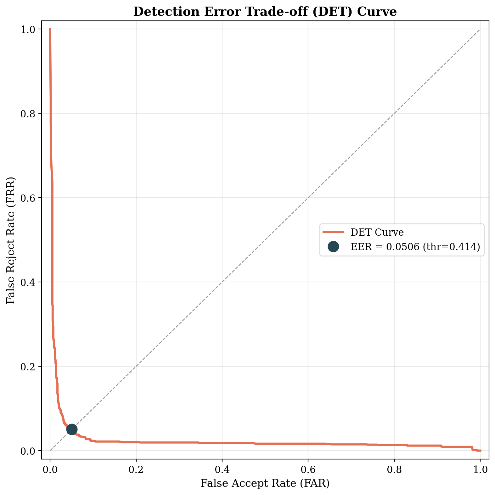
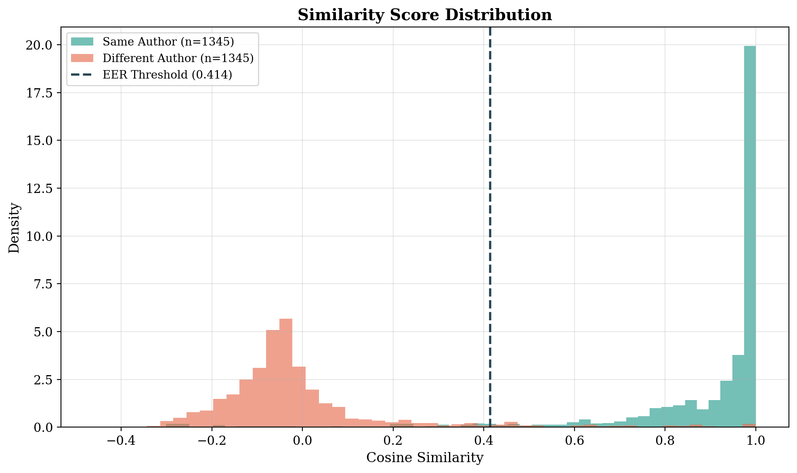

# Code Authorship Identification & Verification

[](https://www.python.org/)
[](https://pytorch.org/)
[](https://pyg.org/)
[](https://tree-sitter.github.io/)

A multimodal deep learning framework for **Source Code Authorship Analysis** in C/C++. This repository provides end-to-end pipelines for:

1. **Code Attribution (Closed-Set Identification)**: Classifying source code among $N$ candidate programmers or distinguishing human-written code from AI-generated solutions.
2. **Code Verification (Open-Set Metric Learning)**: Determining whether two arbitrary code snippets were written by the same author—even for developers never seen during training—via Siamese deep metric learning.

---

## Architecture Overview



The system extracts complementary stylistic and syntactic representations from source code:

- **Sequential & Lexical Stylometry**:
  - Character-level tokenization preserving fine-grained developer habits (indentation, bracket placement, naming casing, spacing).
  - Bidirectional LSTM (BiLSTM) with self-attention pooling.
  - Domain-specific stylometric features: identifier casing conventions (camelCase, snake_case, ALL_CAPS), C++ keyword frequency profiles, and control flow distributions (`for` vs. `while`).

- **Syntactic Structural Representation (AST + GNN)**:
  - Full AST construction using high-performance Tree-sitter C++ parsing (`tree-sitter-cpp`).
  - Graph representation with syntax node types as attributes and hierarchical parent-child relationships as directed edges.
  - Multi-layer Graph Attention Network (`GATConv`) with multi-head attention and global pooling (mean/max) to capture algorithmic structure invariant to formatting.

- **Multimodal Fusion**:
  - **Joint / Concatenation Fusion**: Fuses sequential stylometric vectors with AST graph embeddings for unified classification.
  - **Cross-Attention Fusion**: Query-Key-Value attention mechanism bridging sequence token states and AST graph node representations before pooling.
  - **Ensemble & Weight Averaging**: Soft-voting ensembles and parameter interpolation across independently trained modalities.

- **Open-Set Deep Metric Learning (Siamese Networks)**:
  - Joint Triplet Margin Loss and Contrastive Loss.
  - Online hard negative and positive pair sampling.
  - Author-disjoint train/val/test splits ensuring true open-set zero-leakage evaluation.
  - Dynamic threshold optimization maximizing validation F1 score and Equal Error Rate (EER) minimization.

---

## Repository Structure

```
code-authorship/
├── code_attribution/               # Closed-set authorship identification
│   ├── sequential.py               # Char-BiLSTM + lexical feature classifier
│   ├── ast_gnn.py                  # Tree-sitter AST parser + PyG GAT model
│   └── fusion/                     # Multimodal representation fusion
│       ├── fusion.py               # Joint concatenation fusion classifier
│       ├── cross_attention_fusion.py # Cross-attention between tokens and AST
│       ├── ensemble_fusion.py      # Probability ensemble of base classifiers
│       └── weight_average_fusion.py# Model weight averaging and interpolation
├── code_verification/              # Open-set authorship verification
│   ├── siamese/
│   │   └── triplet_contrastive.py  # Hybrid Triplet & Contrastive metric learning
│   └── multisiamese/
│       ├── multisiam.py            # Multimodal Siamese verification system
│       └── siamese.py              # Pairwise contrastive verification & F1 tuning
├── data_processing/                # Preprocessing and dataset pipelines
│   ├── data_clean.py               # C++ filtering, deduplication, and cleaning
│   ├── process_parquet_to_csv.py   # Parquet extraction & schema alignment
│   ├── detector_utils.py           # ROC, DET, AUC, and EER metric utilities
│   └── visualize_embeddings.py     # t-SNE / PCA clustering visualizations
├── plots/                          # Architecture diagrams and evaluation figures
│   ├── architecture_diagram.png    # End-to-end framework diagram
│   ├── tsne_before_vs_after.png    # Embedding space separation before & after training
│   ├── roc_curve_test.png          # ROC curve for verification
│   ├── det_curve_test.png          # Detection Error Tradeoff (DET) curve
│   ├── confusion_matrix_test.png   # Verification confusion matrix
│   ├── similarity_histogram_test.png # Same vs different author similarity distribution
│   └── training_curves.png         # Loss and metric training history
├── pyproject.toml                  # Project dependencies and packaging metadata
└── uv.lock                         # Pinned dependency lockfile
```

---

## Results & Visualizations

### Embedding Space Separation (t-SNE)
Before metric learning, code embeddings from different authors are heavily entangled. After training with hybrid contrastive and triplet loss, author styles form compact, well-separated clusters:



### Verification Performance
The verification system cleanly separates same-author pairs from different-author pairs:

| Evaluation Metric | Visual Summary |
|---|---|
| **ROC & AUC** |  |
| **Detection Error Tradeoff (DET)** |  |
| **Cosine Similarity Distribution** |  |

---

## Installation

### Prerequisites
- Python >= 3.12
- C/C++ compiler toolchain (required for building Tree-sitter parsers)
- CUDA-enabled GPU (optional, automatically falls back to CPU)

### Setup with `uv` (Recommended)

```bash
# Clone the repository
git clone git@github.com:IrishBumfuzzle/code-authorship.git
cd code-authorship

# Install dependencies using uv
uv sync
```

### Setup with `pip`

```bash
python3 -m venv .venv
source .venv/bin/activate
pip install -e .
```

Key dependencies include:
- `torch` (>= 2.10.0)
- `torch-geometric` (>= 2.5.0)
- `tree-sitter` (>= 0.23.0) & `tree-sitter-cpp` (>= 0.23.0)
- `scikit-learn`, `scipy`, `pandas`, `numpy`
- `matplotlib`, `seaborn`

---

## Dataset Format & Preprocessing

The training pipelines expect CSV files located in `datasets/` containing at least:
- `flines`: Raw source code string.
- `username`: Author identity string (or class label).
- `task`: Problem or task identifier (used for deduplication).

### 1. Clean and Deduplicate Datasets
```bash
python data_processing/data_clean.py \
  --input raw_datasets/ \
  --output datasets/cleaned.csv
```

### 2. Extract C++ Solutions from Parquet Files
```bash
python data_processing/process_parquet_to_csv.py \
  benchmark.parquet \
  --cleaned datasets/cleaned.csv \
  --out datasets/ai_hum.csv
```

---

## Training & Evaluation

### 1. Code Attribution (Closed-Set)

- **Sequential BiLSTM Model**:
  ```bash
  python code_attribution/sequential.py
  ```

- **AST Graph Attention Network**:
  ```bash
  python code_attribution/ast_gnn.py
  ```

- **Multimodal Concatenation Fusion**:
  ```bash
  python code_attribution/fusion/fusion.py
  ```

- **Cross-Attention Multimodal Fusion**:
  ```bash
  python code_attribution/fusion/cross_attention_fusion.py
  ```

- **Ensemble Evaluation**:
  ```bash
  python code_attribution/fusion/ensemble_fusion.py
  ```

### 2. Code Verification (Open-Set Deep Metric Learning)

- **Hybrid Triplet & Contrastive Verification**:
  ```bash
  python code_verification/siamese/triplet_contrastive.py
  ```
  Runs a two-phase training protocol (warmup on projection head followed by end-to-end fine-tuning with cosine annealing and author-disjoint splits). Saves checkpoint to `model/siamese_verification.pt`.

- **Multi-Modal Siamese Verification**:
  ```bash
  python code_verification/multisiamese/multisiam.py
  ```

---

## Quickstart: Verification Inference API

Once a verification checkpoint is trained, you can verify whether two arbitrary C++ snippets were written by the same author in Python:

```python
from code_verification.siamese.triplet_contrastive import load_verifier, verify

# Load trained checkpoint
model, vocab, lex_extractor, threshold = load_verifier(
    "model/siamese_verification.pt", 
    device="cuda"
)

snippet_a = """
#include <iostream>
#include <vector>
using namespace std;

int main() {
    int n;
    if (!(cin >> n)) return 0;
    vector<int> a(n);
    for (int i = 0; i < n; ++i) cin >> a[i];
    return 0;
}
"""

snippet_b = """
#include <bits/stdc++.h>
using namespace std;

void solve() {
    int num_items;
    cin >> num_items;
    vector<int> items(num_items);
    for (auto &x : items) cin >> x;
}

int main() {
    ios_base::sync_with_stdio(false);
    cin.tie(NULL);
    solve();
    return 0;
}
"""

# Verify pair
same_author, confidence = verify(
    model, vocab, lex_extractor, threshold, snippet_a, snippet_b
)

print(f"Same Author Prediction : {same_author}")
print(f"Cosine Similarity      : {confidence:.4f} (Threshold: {threshold:.4f})")
```

---

## License

This project is licensed under the MIT License.
